# Sistem Informasi Perpustakaan

Aplikasi web untuk mengelola data perpustakaan sekolah, mencakup anggota, koleksi buku, peminjaman, dan laporan. Dibuat sebagai project tugas sekolah.

**Pembuat:** Ivanna Maulida Ikmala

---

## Tampilan Aplikasi

Berikut merupakan dokumentasi tampilan Sistem Informasi Perpustakaan.

### 1. Halaman Publik

**Dashboard Publik**

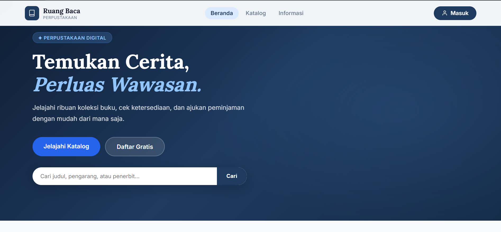

**Katalog Buku Publik**

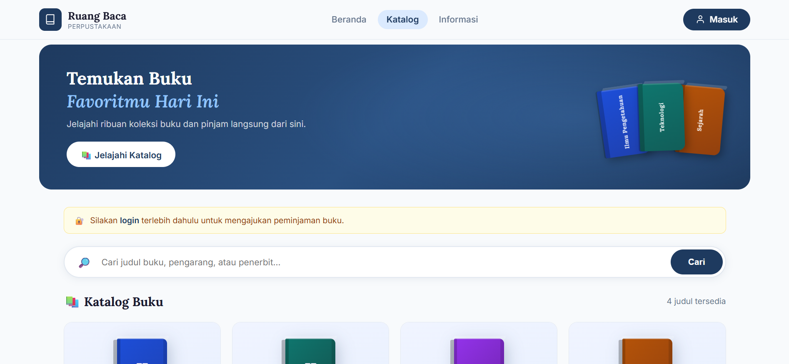

**Informasi Perpustakaan**

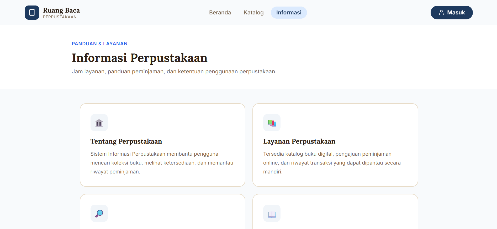

### 2. Halaman Autentikasi

**Login**

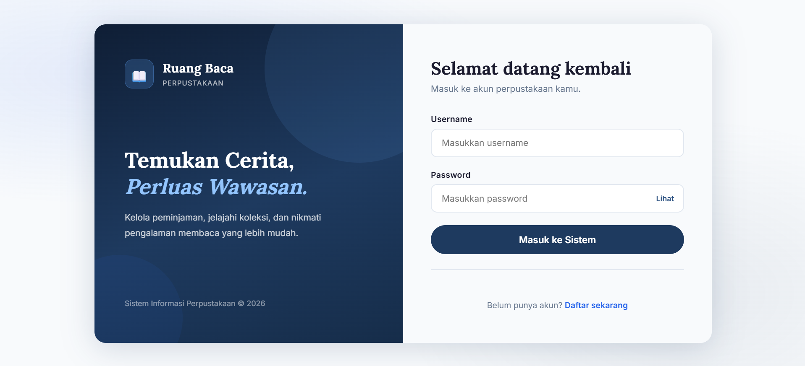

**Registrasi Akun**

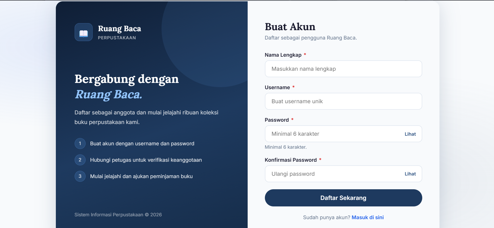

### 3. Halaman User

**Dashboard User**

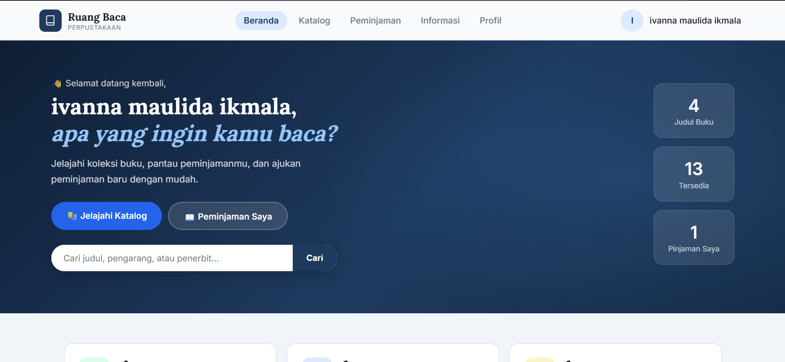

**Katalog Buku**

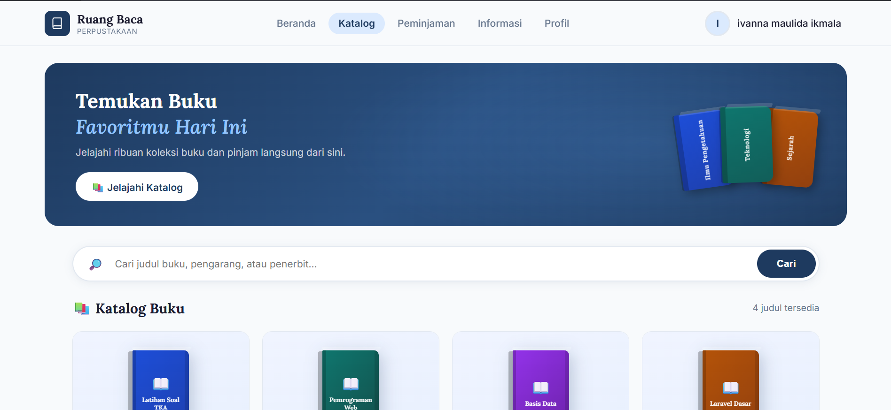

**Informasi Perpustakaan**

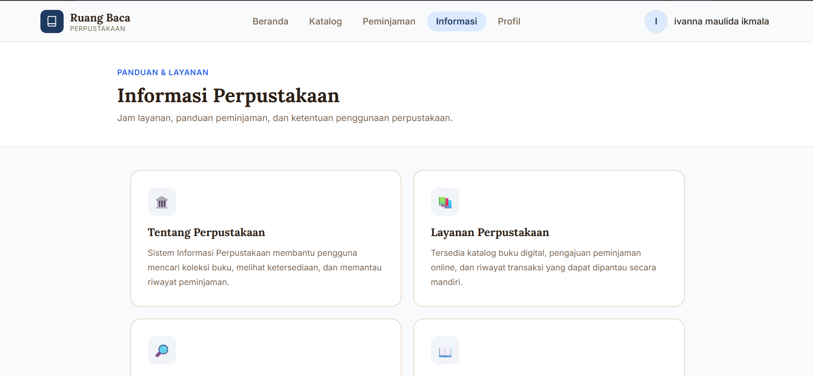

**Peminjaman Saya**

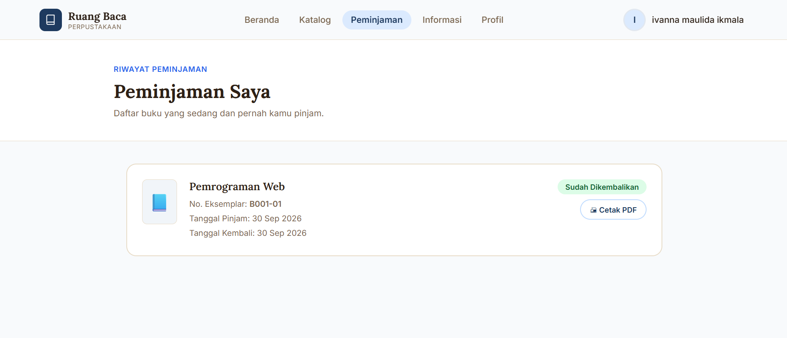

**Profil User**

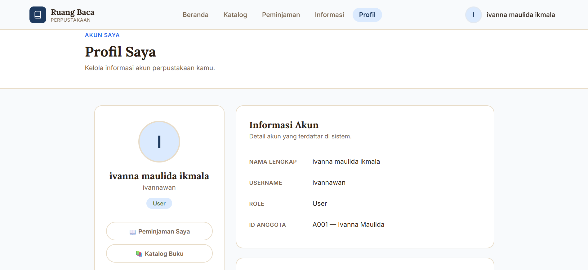

### 4. Halaman Admin

**Dashboard Admin**

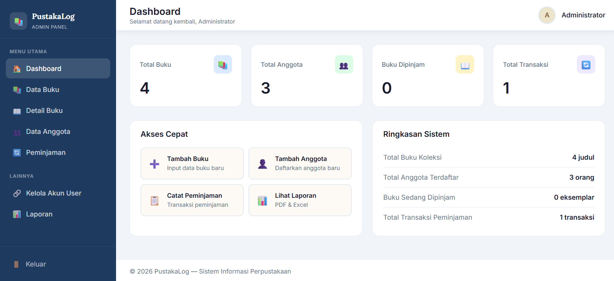

**Data Buku**

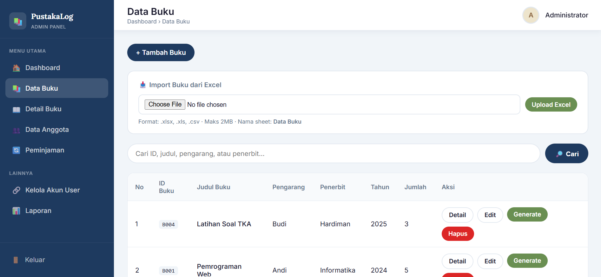

**Detail Buku**

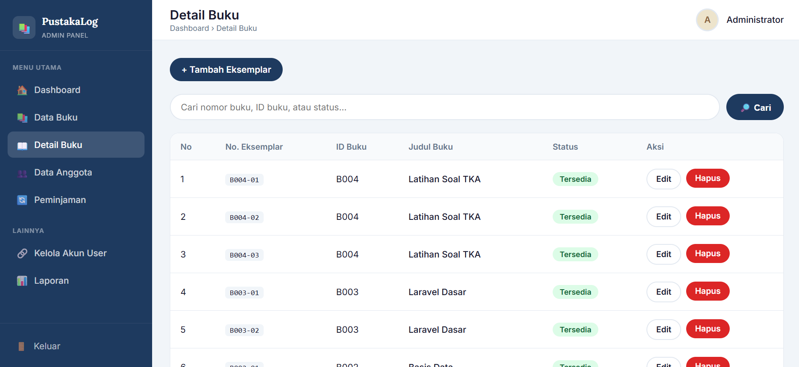

**Detail Anggota**

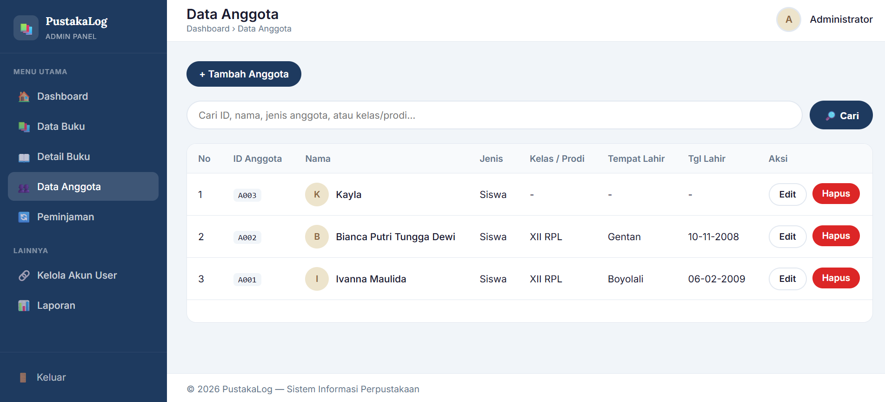

**Peminjaman**

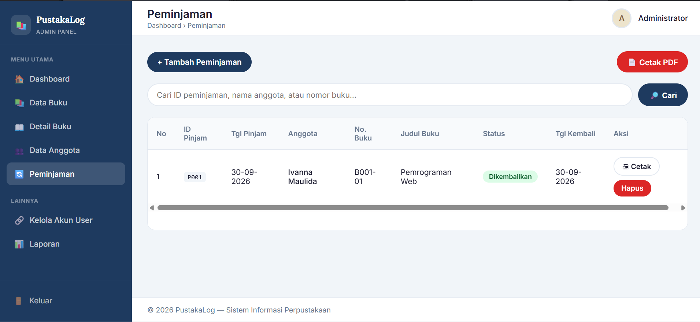

**Kelola Akun User**

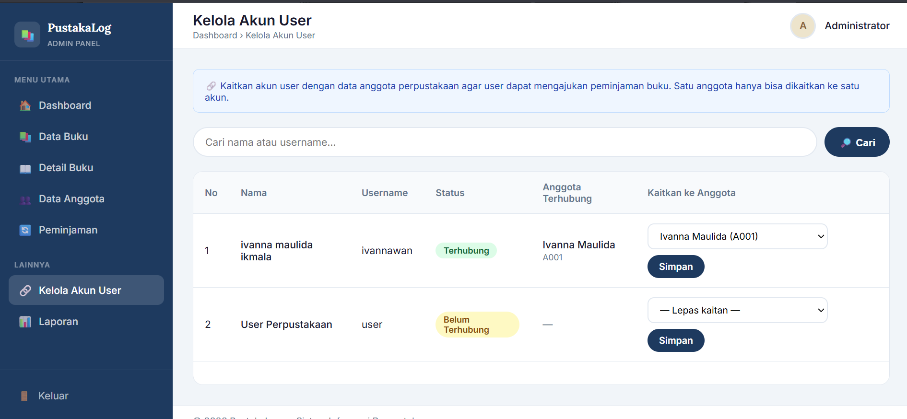

**Laporan Peminjaman**

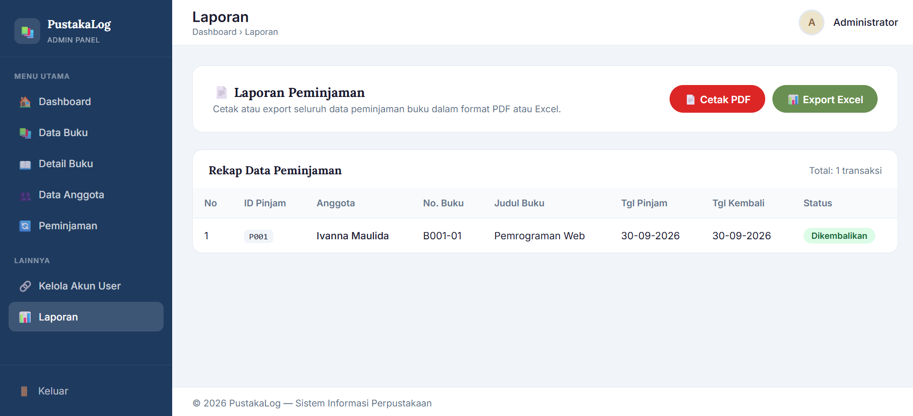

---

## Teknologi

| Komponen | Versi |
|---|---|
| Laravel | 12 |
| PHP | 8.2 |
| MySQL / MariaDB | 10.4+ (XAMPP) |
| Blade + HTML/CSS/JS | — |
| Laravel Excel (Maatwebsite) | 3.1 |
| DomPDF (barryvdh) | 3.1 |

---

## Fitur Aplikasi

### Sisi Admin

- Login dan logout
- Dashboard dengan statistik (total buku, anggota, peminjaman)
- CRUD anggota perpustakaan
- CRUD buku dan import dari Excel
- Manajemen eksemplar buku (detail buku) dengan generate otomatis
- Pencatatan peminjaman dan pengembalian buku
- Kelola akun user - kaitkan akun dengan data anggota
- Laporan peminjaman: cetak PDF dan export Excel
- Pencarian dan pagination pada semua halaman data

### Sisi User

- Registrasi akun (role user otomatis)
- Login dan logout
- Dashboard dengan buku terbaru dari database
- Katalog buku dengan pencarian dan informasi ketersediaan
- Pengajuan peminjaman langsung dari katalog
- Halaman Peminjaman Saya - riwayat peminjaman milik sendiri
- Halaman Profil - ubah nama dan username
- Informasi perpustakaan

---

## Struktur Folder Utama

```text
perpustakaan/
├── app/
│   ├── Exports/                  PeminjamanExport.php
│   ├── Http/
│   │   ├── Controllers/          Semua controller
│   │   └── Middleware/           RoleMiddleware.php
│   ├── Imports/                  BukuImport.php, BukuSheetImport.php
│   └── Models/                   User, Anggota, Buku, DetailBuku, Peminjaman
├── database/
│   └── migrations/               Semua file migration
├── docs/
│   ├── screenshoots/             Screenshot tampilan aplikasi
│   ├── erd.md                    ERD dan struktur database
│   ├── instalasi.md              Panduan instalasi lokal
│   ├── panduan-admin.md          Panduan penggunaan admin
│   ├── panduan-user.md           Panduan penggunaan user
│   
├── public/                       Document root (index.php)
├── resources/views/              Blade templates
│   ├── admin/                    Halaman khusus admin (Kelola Akun User)
│   ├── anggota/                  CRUD anggota
│   ├── auth/                     Login, register
│   ├── buku/                     CRUD buku
│   ├── dashboard/                Dashboard admin dan user
│   ├── detail_buku/              CRUD detail buku
│   ├── laporan/                  Halaman laporan dan template PDF
│   ├── peminjaman/               CRUD peminjaman
│   └── user/                     Halaman user (katalog, peminjaman saya, profil, informasi)
├── routes/web.php                Semua definisi route
└── .env                          Konfigurasi (tidak di-commit)
```

---

## Instalasi Lokal

Lihat panduan lengkap di [`docs/instalasi.md`](docs/instalasi.md).

Ringkasan singkat:

```bash
git clone https://github.com/ivannaone/perpustakaan.git
cd perpustakaan
composer install
npm install && npm run build
cp .env.example .env
php artisan key:generate
# Konfigurasi database di .env
php artisan migrate
php artisan serve
```

---

## Dokumentasi

| Dokumen | Deskripsi |
|---|---|
| [`docs/erd.md`](docs/erd.md) | ERD dan struktur tabel database |
| [`docs/instalasi.md`](docs/instalasi.md) | Instalasi dan konfigurasi lokal |
| [`docs/panduan-admin.md`](docs/panduan-admin.md) | Panduan penggunaan untuk admin |
| [`docs/panduan-user.md`](docs/panduan-user.md) | Panduan penggunaan untuk user |

---

## Akun Demo

| Role | Username | Password |
|---|---|---|
| Admin | admin | (sesuai yang di-setup saat instalasi) |
| User | (daftar via halaman Register) | (password yang didaftarkan) |

Jangan gunakan password pribadi untuk akun demo.

---

## Lisensi

Project ini dibuat untuk keperluan tugas sekolah.
