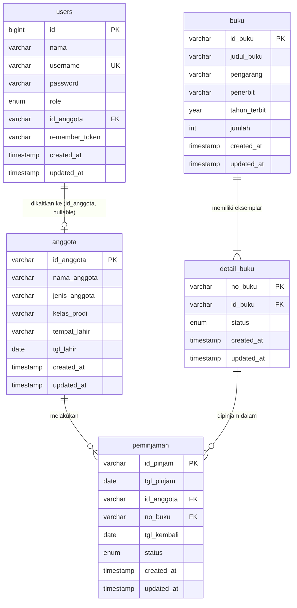

# Entity Relationship Diagram

## Sumber Data

Struktur di bawah ini diverifikasi langsung dari database MySQL `perpustakaan`
menggunakan query `SHOW FULL COLUMNS` dan `INFORMATION_SCHEMA.KEY_COLUMN_USAGE`
pada tanggal audit. Bukan sekadar asumsi dari migration.

## Tabel Aplikasi Utama

| Tabel | Keterangan |
|---|---|
| `users` | Akun login (admin & user) |
| `anggota` | Data anggota perpustakaan |
| `buku` | Data buku |
| `detail_buku` | Eksemplar fisik setiap buku |
| `peminjaman` | Transaksi peminjaman |

## Tabel Pendukung Laravel

| Tabel | Keterangan |
|---|---|
| `sessions` | Penyimpanan sesi login |
| `cache` | Cache aplikasi |
| `jobs` | Antrian pekerjaan (queue) |
| `migrations` | Riwayat migration |
| `password_reset_tokens` | Token reset password |
| `bukus` | Tabel kosong sisa migration percobaan — tidak digunakan aplikasi |

## Struktur Kolom Terverifikasi

### users

| Kolom | Tipe | Nullable | Keterangan |
|---|---|---|---|
| `id` | bigint unsigned | NOT NULL | PK, auto increment |
| `nama` | varchar(100) | NOT NULL | |
| `username` | varchar(50) | NOT NULL | UNIQUE |
| `password` | varchar(255) | NOT NULL | bcrypt hash |
| `role` | enum('admin','user') | NOT NULL | DEFAULT: user |
| `id_anggota` | varchar(10) | NULL | UNIQUE, FK → anggota |
| `remember_token` | varchar(100) | NULL | |
| `created_at` | timestamp | NULL | |
| `updated_at` | timestamp | NULL | |

### anggota

| Kolom | Tipe | Nullable | Keterangan |
|---|---|---|---|
| `id_anggota` | varchar(10) | NOT NULL | PK |
| `nama_anggota` | varchar(100) | NOT NULL | |
| `jenis_anggota` | varchar(20) | NOT NULL | Siswa/Guru/Mahasiswa/Staff/Umum |
| `kelas_prodi` | varchar(50) | NULL | |
| `tempat_lahir` | varchar(30) | NULL | |
| `tgl_lahir` | date | NULL | |
| `created_at` | timestamp | NULL | |
| `updated_at` | timestamp | NULL | |

### buku

| Kolom | Tipe | Nullable | Keterangan |
|---|---|---|---|
| `id_buku` | varchar(10) | NOT NULL | PK |
| `judul_buku` | varchar(150) | NOT NULL | |
| `pengarang` | varchar(100) | NOT NULL | |
| `penerbit` | varchar(100) | NULL | |
| `tahun_terbit` | year(4) | NULL | |
| `jumlah` | int(11) | NOT NULL | DEFAULT: 0, total eksemplar |
| `created_at` | timestamp | NULL | |
| `updated_at` | timestamp | NULL | |

### detail_buku

| Kolom | Tipe | Nullable | Keterangan |
|---|---|---|---|
| `no_buku` | varchar(20) | NOT NULL | PK, contoh: B001-01 |
| `id_buku` | varchar(10) | NOT NULL | FK → buku |
| `status` | enum('ada','dipinjam') | NOT NULL | DEFAULT: ada |
| `created_at` | timestamp | NULL | |
| `updated_at` | timestamp | NULL | |

### peminjaman

| Kolom | Tipe | Nullable | Keterangan |
|---|---|---|---|
| `id_pinjam` | varchar(10) | NOT NULL | PK, contoh: P0001 |
| `tgl_pinjam` | date | NOT NULL | |
| `id_anggota` | varchar(10) | NOT NULL | FK → anggota |
| `no_buku` | varchar(20) | NOT NULL | FK → detail_buku |
| `tgl_kembali` | date | NULL | |
| `status` | enum('dipinjam','dikembalikan') | NOT NULL | DEFAULT: dipinjam |
| `created_at` | timestamp | NULL | |
| `updated_at` | timestamp | NULL | |

## Foreign Key Terverifikasi dari Database

| Constraint | Tabel | Kolom | Referensi | On Delete |
|---|---|---|---|---|
| `users_id_anggota_foreign` | users | id_anggota | anggota.id_anggota | SET NULL |
| `detail_buku_id_buku_foreign` | detail_buku | id_buku | buku.id_buku | CASCADE |
| `peminjaman_id_anggota_foreign` | peminjaman | id_anggota | anggota.id_anggota | RESTRICT |
| `peminjaman_no_buku_foreign` | peminjaman | no_buku | detail_buku.no_buku | RESTRICT |

## Diagram ERD (Mermaid)

## Keterangan Kardinalitas

| Relasi | Kardinalitas | Keterangan |
|---|---|---|
| users → anggota | 0..1 : 1 | Satu user bisa dikaitkan ke satu anggota. Anggota bisa tidak punya akun. |
| anggota → peminjaman | 1 : 0..N | Satu anggota bisa punya banyak transaksi peminjaman. |
| buku → detail_buku | 1 : 1..N | Satu buku harus punya minimal satu eksemplar. |
| detail_buku → peminjaman | 1 : 0..N | Satu eksemplar bisa dipinjam berkali-kali (secara historis). |

## Catatan

- Tabel `bukus` ada di database tetapi kosong dan tidak digunakan oleh aplikasi.
  Ini adalah sisa migration percobaan (`2026_09_30_012541_create_bukus_table.php`).
- Tabel `sessions` digunakan aktif untuk penyimpanan sesi login (SESSION_DRIVER=database).
- Kolom `users.id_anggota` nullable dan unique — satu anggota hanya bisa dikaitkan
  ke satu akun, dan akun yang belum dikaitkan nilainya NULL.
- ON DELETE RESTRICT pada `peminjaman` memastikan anggota dan eksemplar yang masih
  punya riwayat peminjaman tidak bisa dihapus sembarangan dari database.
